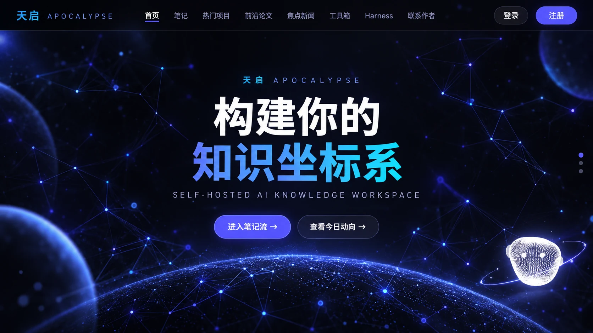

<div align="center">



# Apocalypse

**A self-hosted knowledge workspace that connects notes, papers, developer trends, news, and an inspectable AI agent.**

[简体中文](README.md) · [Quick start](#quick-start) · [Features](#feature-map) · [Roadmap](ROADMAP.md) · [Contributing](CONTRIBUTING.md) · [Issues](https://github.com/lauxian5520/Apocalypse/issues)

[](LICENSE)
[](https://www.python.org/)
[](https://fastapi.tiangolo.com/)
[](https://docs.docker.com/compose/)
[](https://github.com/lauxian5520/Apocalypse/releases)
[](https://github.com/lauxian5520/Apocalypse/stargazers)

</div>

## Why Apocalypse?

- **More than another chat box.** Notes, papers, GitHub Trending, Hugging Face models, and news live in one workflow where AI can explain and summarize page context.
- **An agent you can inspect.** Review model-visible messages, tool calls, approvals, token usage, append-only events, and complete replayable trajectories.
- **Self-hosted by design.** Run the FastAPI backend, native frontend, and SQLite storage with Docker Compose. All mutable state is contained in `var/` for simple backups.
- **Provider-neutral.** Use DeepSeek, Zhipu, Gemini, OpenAI, Ollama, or any compatible endpoint.
- **The same runtime is an RL environment.** `rl/` turns the agent into a reproducible Deep Research reinforcement-learning environment — frozen corpus, exact verifiers, leakage filtering, concurrent rollout, token-level loss masks, GRPO — with a measurement behind every design decision, including the one that overturned the first design.

If Apocalypse is useful to you, consider giving it a ⭐. It helps other developers looking for a self-hosted knowledge workspace discover the project.

## Feature map

| Knowledge inputs | AI and execution | Capture and collaboration |
|---|---|---|
| GitHub Trending, Hugging Face, arXiv, multi-source news | Streaming chat, page summaries, explanations, tool calling | Markdown notes, multi-image posts, comments, direct messages |
| Daily, weekly, and monthly feeds | Human approval, sandboxing, trajectory inspection, context compression | Local database, unified backups, admin console |
| HotpotQA frozen corpus (66,581 passages, hashed) | Agentic RL: verifiers, concurrent rollout, GRPO | The event log is the training trajectory; environment fingerprints make runs reproducible |

### Agent workbench highlights

- Replaceable model, tool registry, session store, and sandbox interfaces.
- Append-only event log as the source of truth for model-message projection.
- Fork and replay from any event; raw events are never deleted during context compression.
- Production keeps Shell disabled and Harness admin-only. Workspace writes require approval by default; subagents deny actions that would require human approval. Private notes, comments, and files are visible only to their author and administrators; direct messages and their files are restricted to the two participants.
- A three-pane workbench that fits one screen by default: drag any divider (double-click to reset), resize the composer or any tool output, or switch to wide mode. Long turns stay responsive because the inspector appends events instead of re-rendering, and reloading during a running turn reattaches to it with the interrupt button available.
- Tool arguments are parsed tolerantly — raw newlines inside a `write` payload are recovered byte-for-byte — while a call truncated by the output cap is reported as truncation, not as bad JSON.
- Cost estimates use an exact model-name match in the built-in price table or `PRICING_FILE`. Unknown models show “price not configured”; malformed prices remain errors. Interrupted requests may lack final token usage, so observed usage is not a complete invoice.

## Deep Research RL environment

`rl/` builds a **reproducible, offline, deterministic** multi-hop retrieval environment on top of the agent runtime. The environment, reward, and verifiers are the deliverable, and every design decision is backed by a measurement. The full design and all measurements are in [rl/README.md](rl/README.md) (Chinese); [rl/GPU_QUICKSTART.md](rl/GPU_QUICKSTART.md) goes from clone to training on a GPU box.

**The first design was measured and discarded.** It was built on a self-collected 50k-paper arXiv corpus. Retrieving a paper from its own eight rarest abstract words hit top-1 100% of the time, and still did after every corpus-rare word was removed. Difficulty has to come from confusable near-duplicates *in the corpus* — no rewording fixes that — so the environment moved to HotpotQA distractor:

| Same measurement | arXiv 50k | HotpotQA 66.6k |
|---|---|---|
| Runner-up / top BM25 score ratio (median) | 0.28 | **0.84** |
| Questions with a >0.8 competitor | 0% | **58%** |

**Leakage filtering is the step that matters most.** Nearly half the questions can be answered closed-book, and training on those rewards recall, not retrieval. The two models' leaked sets do not contain each other, so leakage is a property of the *(question, model)* pair and the filter takes the union:

```
7405 questions − 3684 answerable closed-book (49.8%) − 897 incompletely covered = 2824 kept
train 1908 · dev 457 · test 459, each frozen with a sha256
```

RL shares corpus tools and event projection with Harness while retaining the one-way dependency `rl/ → harness`. Corpus tools are disabled on the site by default (`HARNESS_CORPUS_ENABLED=false`).

**Training results:** Qwen3-8B completed 710 SFT steps and 500 GRPO steps. The adapters, training logs, and per-task trajectories are available.

Hugging Face weights: [SFT adapter](https://huggingface.co/lauxian5520/apocalypse-qwen3-8b-sft) · [GRPO-500 adapter](https://huggingface.co/lauxian5520/apocalypse-qwen3-8b-grpo500) · [author profile](https://huggingface.co/lauxian5520). These repositories contain LoRA adapters and require the `Qwen/Qwen3-8B` base model.

| Split | Base | SFT | GRPO-500 |
|---|---|---|---|
| dev (457 tasks) | 97/457 (21.2%) | 170/457 (37.2%) | 187/457 (40.9%) |
| test (459 tasks) | No comparison supplied | 162/459 (35.3%) | 190/459 (41.4%) |

Accuracy uses every selected task as the denominator, with errors and missing trajectories counted as failures. Results come from the existing single training run and do not establish performance across random seeds.

## Quick start

### Docker Compose (HTTP development)

```bash
git clone https://github.com/lauxian5520/Apocalypse.git
cd Apocalypse
cp .env.example .env
# Set a random JWT_SECRET; configure a provider if needed.
mkdir -p var
sudo chown -R 10001:10001 var
docker compose up --build -d --wait
docker compose exec backend python -m cli.users admin admin@example.com --admin
```

Open <http://localhost> and log in with the CLI-created account. The CLI reads passwords interactively. Basic accounts, notes, and messages do not depend on model API availability. The backend port is not published to the host.

### Local development (Python 3.12)

```bash
cp .env.example .env
python -m venv .venv
.venv/bin/python -m pip install -r backend/requirements.txt -c constraints/web-py312.txt
cd backend
../.venv/bin/python -m cli.users admin admin@example.com --admin
../.venv/bin/python main.py
```

Open <http://localhost:8000>. Web and RL use separate dependency environments; pinned versions are under `constraints/`.

### HTTPS production

Prepare the target server, domain, and valid TLS certificate. Place the certificate and key at `deploy/certs/fullchain.pem` and `deploy/certs/privkey.pem`; set a random `JWT_SECRET` of at least 32 characters and exact HTTPS `ALLOWED_ORIGINS` in `.env`, then initialize the data directory permissions as above.

```bash
docker compose -f docker-compose.yml -f docker-compose.production.yml up --build -d --wait
docker compose -f docker-compose.yml -f docker-compose.production.yml exec backend python -m cli.users admin admin@example.com --admin
```

Production enforces secure cookies, disables public registration by default, keeps Harness admin-only, and rejects enabled Shell. Create invited accounts with the same CLI without `--admin`. Use a single backend process with SQLite. `/healthz` is a liveness probe; `/readyz` checks the database and writable data directories independently of external APIs.

See the [deployment and restore guide](docs/DELIVERY.md) for certificate setup, backup commands, retention, and rollback. Stop backend writes before backing up; the backup tool snapshots SQLite and archives runtime files, while restore verifies integrity and refuses nonempty destinations.

## Architecture

```text
rl/  ------------------>  harness        (one-way: backend/ never imports rl/)
routers  ->  services | harness  ->  models
    \-------------- all layers ------------>  core
```

- `backend/core`: configuration, storage paths, security, database, providers, SSE, and domain errors.
- `backend/services`: application logic independent from FastAPI request objects.
- `backend/harness`: event-sourced agent loop, tools, approvals, sandbox, adapters, and session projection. `harness/corpus/` holds the frozen-corpus reader and hand-written BM25 index, shared by the `corpus_*` tools and `rl/` so both see exactly the same thing.
- `rl`: the Deep Research RL environment — corpus and task pipeline, verifiers, rollout engine, evaluation, and the SFT/GRPO trainer. It sits outside `backend/` and depends only inward, which keeps torch out of the web server's import graph.
- `frontend`: dependency-light HTML, CSS, and JavaScript UI.
- `var`: the only mutable runtime directory; database, uploads, feeds, music, and agent workspaces.

For the architecture, security model, and tool contracts, see the [Chinese technical documentation](README.md#-项目结构).

## Configuration

Copy `.env.example` to `.env`. The most important settings are:

| Variable | Purpose |
|---|---|
| `APP_ENV` | `development`, `production`, or `test`; production validates deployment settings |
| `REGISTRATION_ENABLED` | Public signup; disabled by default in production |
| `PRICING_FILE` | Optional complete custom model pricing JSON |
| `FEEDS_ENABLED` | Enable background feed collection |
| `HARNESS_WRITE_APPROVAL` | Require approval for workspace writes; default `true` |
| `HARNESS_AUTO_TITLE` | Automatic session titles |
| `AI_PROVIDER` | `deepseek`, `gemini`, `zhipu`, `openai`, `ollama`, or `custom` |
| `JWT_SECRET` | Authentication and captcha signing secret; change before deployment |
| `COOKIE_SECURE` | Enable after HTTPS is configured |
| `HARNESS_REQUIRE_ADMIN` | Keep the agent workbench admin-only on public deployments |
| `HARNESS_SHELL_ENABLED` | Disabled by default; read the security model before enabling |
| `HARNESS_MAX_TOKENS` | Output cap per model call (default `8192`). Too low truncates a `write` mid-arguments, and a truncated tool call cannot be recovered |
| `HARNESS_CORPUS_ENABLED` | Exposes the `corpus_*` retrieval tools for the RL environment. Off by default; the live site is unaffected |
| `VAR_DIR` | Root directory for all mutable runtime state |

The full table, including subagent limits and context-compression budget, is in the [Chinese README](README.md) (section 配置说明).

## Contributing and security

Bug reports, feature proposals, documentation improvements, and focused pull requests are welcome. Read [CONTRIBUTING.md](CONTRIBUTING.md) before opening a PR. Please report vulnerabilities privately as described in [SECURITY.md](SECURITY.md).

## License

MIT
